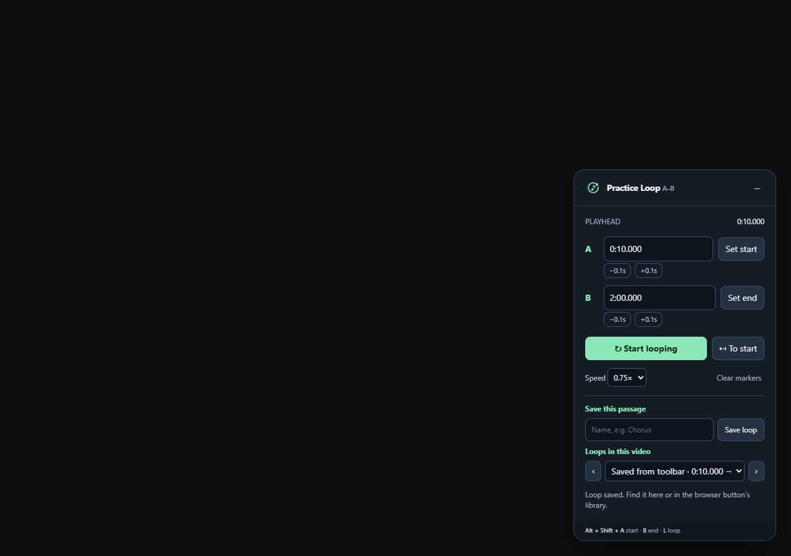

# Practice Loop for YouTube

A Chrome extension for practicing a passage of music directly on YouTube. No build step or dependencies.

## Install

1. Download this repository with **Code → Download ZIP** and extract it, or clone it. Open `chrome://extensions` in Chrome.
2. Turn on **Developer mode** (top right).
3. Click **Load unpacked** and select the extracted/cloned folder containing `manifest.json`.
4. Open or refresh a YouTube video. The **Practice Loop** panel appears at the bottom right.

When updating an existing installation, click **Reload** on the extension in `chrome://extensions`, then refresh any open YouTube tabs. Pin **Practice Loop for YouTube** from Chrome's puzzle-piece Extensions menu to keep the library button in the toolbar.

## Practice

1. Seek to the beginning of a passage and click **Set start** (A).
2. Play or seek to the end and click **Set end** (B).
3. Click **Start looping**. Playback jumps to A and repeats at B.

Edit either timestamp directly (seconds, `m:ss.mmm`, or `h:mm:ss.mmm`), or use the ±0.1s buttons to refine it. The passage must be at least 0.2 seconds long. **To start** plays from A. **Stop looping** turns off repetition while YouTube keeps playing; use YouTube's controls to pause. Speed changes preserve pitch using the browser's media playback support.

Markers are stored locally for each video and restored on a later visit. Looping must be started again after changing videos or reloading. Speed follows the current YouTube player and is not stored by this extension. Minimize with **−**; looping continues while minimized. Controls also follow the player into fullscreen.

## Save and revisit passages

With valid A/B markers, enter an optional name (for example, **Chorus** or **Guitar solo**) and click **Save loop**. Each save creates a separate passage containing the video ID, video title, name, and exact A/B times. Changing working markers does not change previously saved loops.

Click the extension's browser button to see your library grouped by video. Search by video title or loop name, click a passage to open its YouTube video in a new tab, or use **×** to delete it. The selected passage loads and seeks to A once the player is ready; press **Start looping** to begin repeating. The popup also lets you name and save the current YouTube tab's working passage.

On YouTube, **Loops in this video** jumps directly to a saved passage. The **‹** and **›** buttons move between passages in start-time order and wrap at either end. If looping is already enabled, it continues with the selected passage; otherwise selection seeks to A without starting playback. Saved loops stay synchronized between open tabs and the browser button.

Your old automatically saved working markers are preserved. Use **Save loop** to add a working passage to the named library. **Clear markers** clears only the working passage; delete named passages from the browser-button library.

Keyboard shortcuts (while focus is outside text fields):

| Shortcut | Action |
| --- | --- |
| Alt + Shift + A | Mark start |
| Alt + Shift + B | Mark end |
| Alt + Shift + L | Toggle loop |

## Limits and privacy

Works on standard `www.youtube.com/watch` videos, including playlist videos. Shorts, embedded players, and live streams are not supported. Loop checks pause during detected YouTube ads. Loop boundaries depend on browser scheduling and YouTube buffering; this is not sample-accurate or guaranteed gapless, especially in background tabs. YouTube page changes may require an extension update.

Only the `storage` permission and a content script on `https://www.youtube.com/*` are used. The popup uses Chrome's tab API to open saved videos and communicate with the current tab, without requesting browsing-history access. No analytics, extension network requests, account access, or external libraries. Saved markers and named loops stay in Chrome's local extension storage; uninstalling removes all extension storage. Saved loops contain references to videos, not downloaded video or audio.

## Development

Run `npm test` and `npm run check` with Node.js installed. An optional browser integration check is available with `node tests/browser.cjs` when Playwright is installed locally or available on `NODE_PATH`; it uses installed Chrome (override with `CHROME_PATH`). This check uses a simulated YouTube page and media state; it does not verify real YouTube playback or buffering. After changing files, click Reload on this extension in `chrome://extensions`, then refresh YouTube.

Manual release check: mark and loop a passage; edit and nudge markers; change speed; pause/resume; seek outside the loop; test a loop ending at the video's end; minimize; enter fullscreen; navigate to another video and back; refresh to restore markers; check behavior during ads.

Chrome extension API references: [content scripts](https://developer.chrome.com/docs/extensions/develop/concepts/content-scripts) and [local storage](https://developer.chrome.com/docs/extensions/reference/api/storage).
